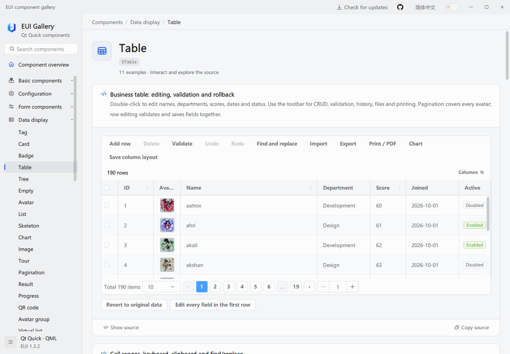
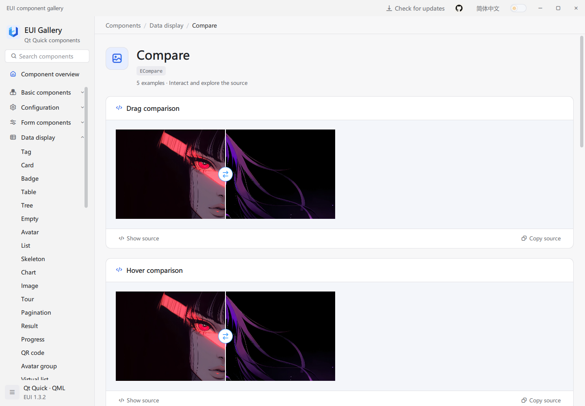
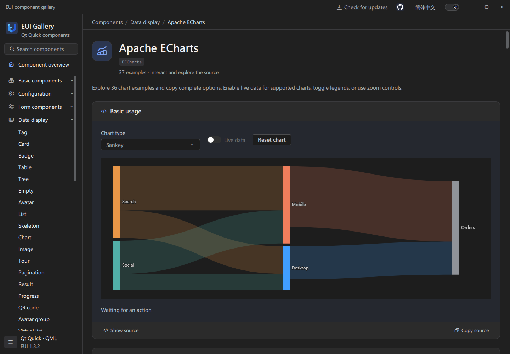
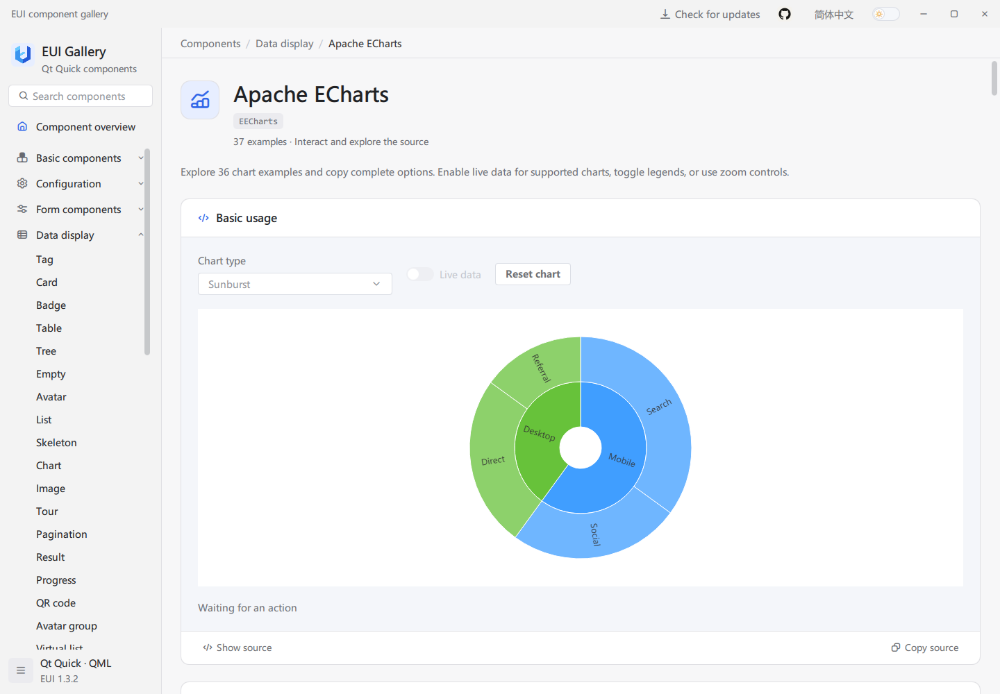
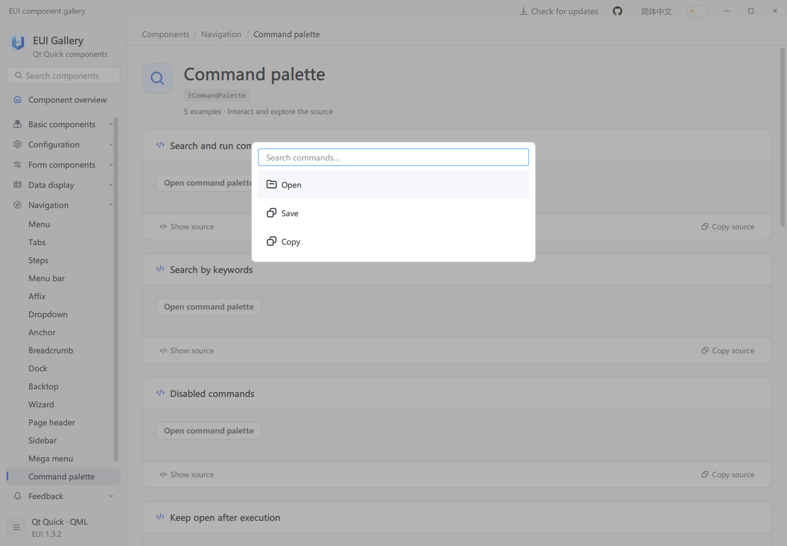
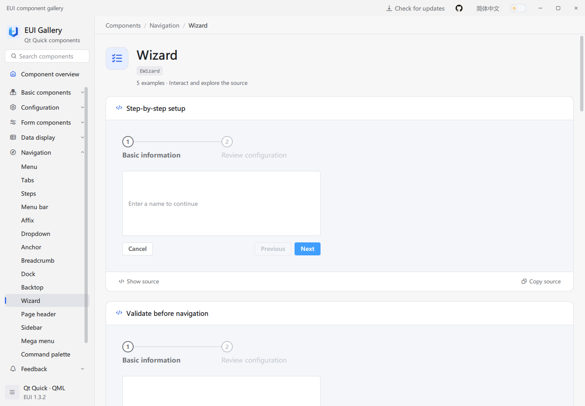

# EUI-PySide6

English | [简体中文](docs/README.zh-CN.md)

EUI-PySide6 is a Qt Quick / QML component library for Python desktop applications using PySide6, with forms, data tables, navigation, charts, image comparison, a scheduler, a task board, a rich text editor, and shared light and dark themes. The Gallery provides interactive examples, copyable QML source, and API references.

## Preview



Edit a table, switch between light and dark themes, and open the example's QML source. The demo and screenshots come from the original EUI Gallery and illustrate the shared QML interface. See [all screenshots](docs/screenshots/README.md) for more components.

## Try the Gallery

Download a package for your system and architecture from [GitHub Releases](https://github.com/lihechuan/EUI-PySide6/releases). Use the installer, or extract the complete portable package and launch the Gallery. Keep its libraries and subdirectories together; packaged applications include Python and Qt and require neither a Python installation nor a Qt SDK.

Direct downloads for [v1.3.2](https://github.com/lihechuan/EUI-PySide6/releases/tag/v1.3.2):

| System | Architecture | Installer | Portable |
| --- | --- | --- | --- |
| Windows | x64 | [EXE](https://github.com/lihechuan/EUI-PySide6/releases/download/v1.3.2/EUI-PySide6-Gallery-1.3.2-windows-x64-setup.exe) | [ZIP](https://github.com/lihechuan/EUI-PySide6/releases/download/v1.3.2/EUI-PySide6-Gallery-1.3.2-windows-x64-portable.zip) |
| macOS | Apple Silicon (arm64) | [DMG](https://github.com/lihechuan/EUI-PySide6/releases/download/v1.3.2/EUI-PySide6-Gallery-1.3.2-macos-arm64.dmg) | [ZIP](https://github.com/lihechuan/EUI-PySide6/releases/download/v1.3.2/EUI-PySide6-Gallery-1.3.2-macos-arm64-portable.zip) |
| macOS | Intel (x64) | [DMG](https://github.com/lihechuan/EUI-PySide6/releases/download/v1.3.2/EUI-PySide6-Gallery-1.3.2-macos-x64.dmg) | [ZIP](https://github.com/lihechuan/EUI-PySide6/releases/download/v1.3.2/EUI-PySide6-Gallery-1.3.2-macos-x64-portable.zip) |

For application development, download the [Python wheel](https://github.com/lihechuan/EUI-PySide6/releases/download/v1.3.2/eui_pyside6-1.3.2-py3-none-any.whl). Verify downloads against [SHA256SUMS.txt](https://github.com/lihechuan/EUI-PySide6/releases/download/v1.3.2/SHA256SUMS.txt). This release does not include Windows x86 or Linux desktop packages.

Search for a component, try its examples, and select **Show source** or **Copy source**. The API below each example explains its properties, methods, and signals. Use the language and theme controls to switch appearance.

## Build from source

Install Python 3.10 or newer (64-bit), then run these commands on Windows. PySide6 supplies the Qt runtime; the EUI support classes are implemented in Python. See the [usage guide](docs/guide.en.md#1-prerequisites) for macOS and Qt Creator setup.

```powershell
git clone https://github.com/lihechuan/EUI-PySide6.git
cd EUI-PySide6
python -m venv .venv
.\.venv\Scripts\python.exe -m pip install -e .
.\.venv\Scripts\python.exe main.py --language en
```

After editing bundled QML or assets, run `python build/resources.py` with the same environment before restarting the Gallery.

## Use in your application

1. Install the release wheel in your application's Python environment, or install this checkout with `python -m pip install -e .`.
2. Create a `QQmlApplicationEngine` and call `eui.initialize(engine)` before loading QML.
3. Use `import EUI 1.0` in QML, then configure controls using the Gallery's examples and API.

Set the environment variable `QT_QUICK_CONTROLS_STYLE=Basic` before creating `QGuiApplication`, as the Gallery does, to support customized controls.

After installing the package and initializing the engine, save this as `Main.qml` and load it from your Python entry point to open a window with a click counter:

```qml
import EUI 1.0
import QtQuick

EApplicationWindow {
    id: window

    property int clicks: 0

    width: 420
    height: 240
    visible: true
    title: "EUI Demo"

    EButton {
        anchors.centerIn: parent
        styleType: EStyle.Primary
        text: "Clicks: " + window.clicks

        onClicked: window.clicks += 1
    }
}
```

The [application integration guide](docs/guide.en.md#3-integrate-a-qt-quick-application) includes a complete Python entry point, QML window, and component examples. The Gallery installer is for trying the components; use the Python wheel to develop your own application.

## More components










The 3D scene is a visual demo with orbit, zoom, and playback controls. It is not an EUI component.





See [all screenshots](docs/screenshots/README.md) for more chart types, forms, source previews, and other components.

## Feedback

- Issues and feature requests: [GitHub Issues](https://github.com/lihechuan/EUI-PySide6/issues)
- **Email: [xiaojiaqaq@gmail.com](mailto:xiaojiaqaq@gmail.com)**

See [CONTRIBUTING.md](CONTRIBUTING.md) for contribution guidelines.

## License

EUI-PySide6 uses the [MIT License](LICENSE). Third-party software and assets retain their own licenses; see [THIRD_PARTY_NOTICES.md](THIRD_PARTY_NOTICES.md).
