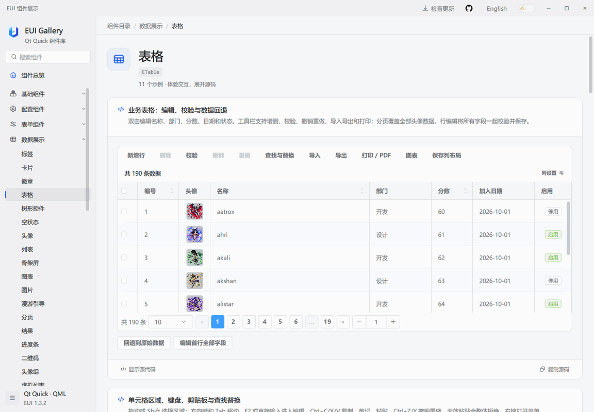
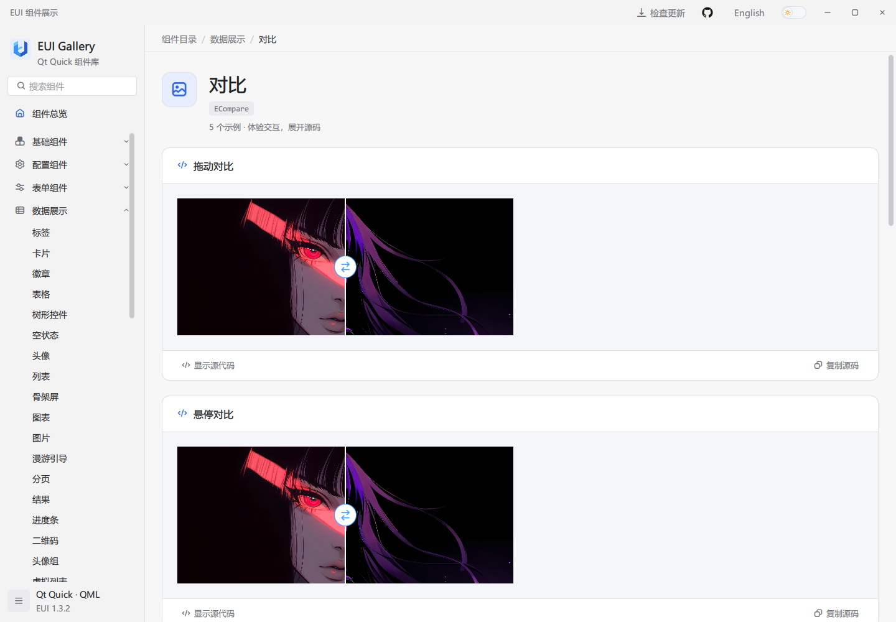
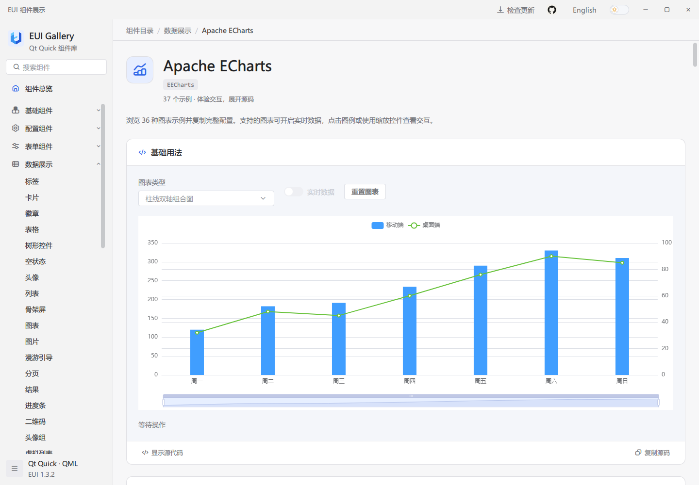
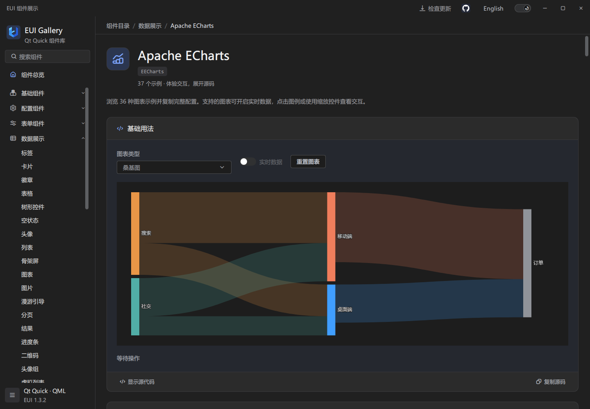
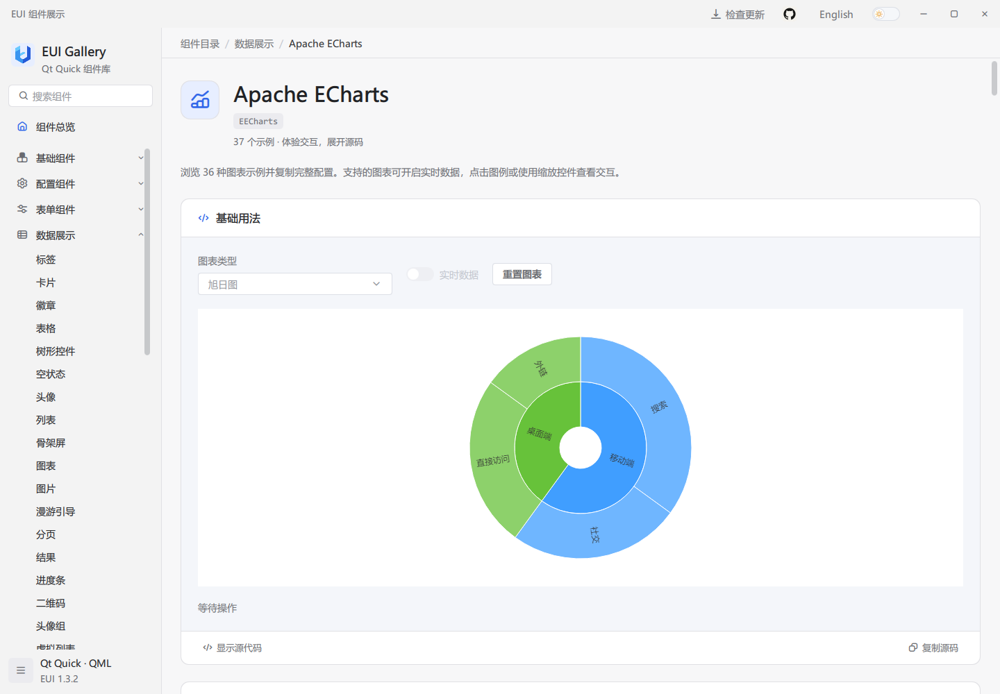
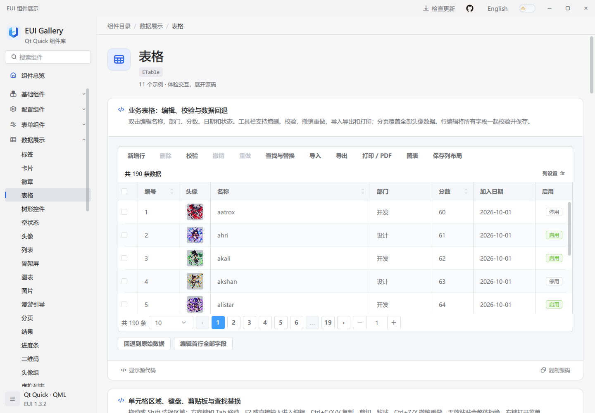
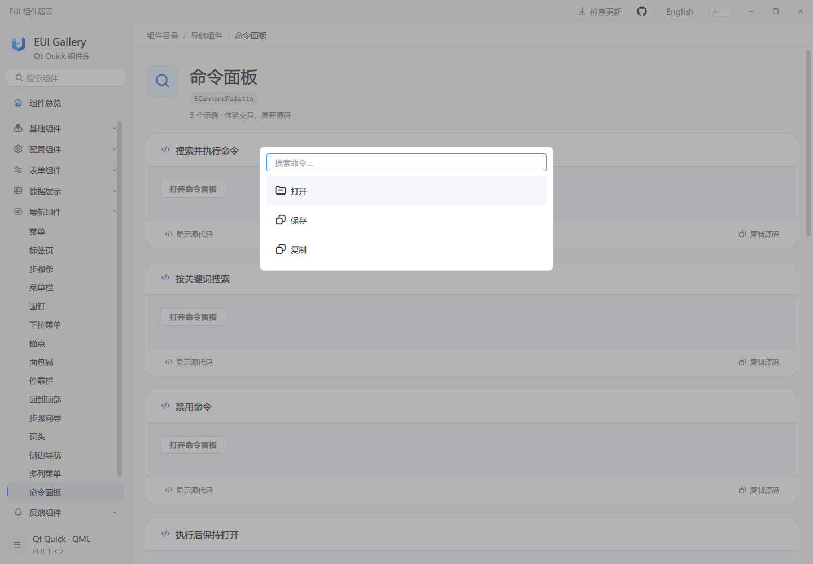

# EUI-PySide6

[English](../README.md) | 简体中文

EUI-PySide6 是使用 PySide6 的 Python Qt Quick / QML 桌面应用组件库，提供表单、数据表格、导航、图表、图片对比、事件排程、任务看板、富文本编辑和统一的明暗主题。Gallery 包含交互示例、可复制的 QML 源码和 API 参考。

## 界面预览



编辑表格、切换明暗主题，再展开示例的 QML 源码。演示和截图沿用原 EUI Gallery，用于展示两者共用的 QML 界面。更多组件见[全部截图](screenshots/README.md)。

## 体验 Gallery

从 [GitHub Releases](https://github.com/lihechuan/EUI-PySide6/releases) 下载匹配系统和架构的安装包或免安装包。安装后启动 Gallery；免安装包需完整解压，保留其中的运行库和子目录。打包后的应用自带 Python 和 Qt，无需另行安装 Python 或 Qt SDK。

[v1.3.2](https://github.com/lihechuan/EUI-PySide6/releases/tag/v1.3.2) 直接下载：

| 系统 | 架构 | 安装包 | 免安装包 |
| --- | --- | --- | --- |
| Windows | x64 | [EXE](https://github.com/lihechuan/EUI-PySide6/releases/download/v1.3.2/EUI-PySide6-Gallery-1.3.2-windows-x64-setup.exe) | [ZIP](https://github.com/lihechuan/EUI-PySide6/releases/download/v1.3.2/EUI-PySide6-Gallery-1.3.2-windows-x64-portable.zip) |
| macOS | Apple Silicon（arm64） | [DMG](https://github.com/lihechuan/EUI-PySide6/releases/download/v1.3.2/EUI-PySide6-Gallery-1.3.2-macos-arm64.dmg) | [ZIP](https://github.com/lihechuan/EUI-PySide6/releases/download/v1.3.2/EUI-PySide6-Gallery-1.3.2-macos-arm64-portable.zip) |
| macOS | Intel（x64） | [DMG](https://github.com/lihechuan/EUI-PySide6/releases/download/v1.3.2/EUI-PySide6-Gallery-1.3.2-macos-x64.dmg) | [ZIP](https://github.com/lihechuan/EUI-PySide6/releases/download/v1.3.2/EUI-PySide6-Gallery-1.3.2-macos-x64-portable.zip) |

开发自己的应用可下载 [Python wheel](https://github.com/lihechuan/EUI-PySide6/releases/download/v1.3.2/eui_pyside6-1.3.2-py3-none-any.whl)。下载后可对照 [SHA256SUMS.txt](https://github.com/lihechuan/EUI-PySide6/releases/download/v1.3.2/SHA256SUMS.txt) 校验文件。本版本未提供 Windows x86 或 Linux 桌面安装包。

搜索组件并操作示例，点击“显示源代码”或“复制源码”。示例下方的 API 说明组件的属性、方法和信号，可通过语言和主题控件切换显示效果。

## 从源码运行

安装 Python 3.10 或更新的 64 位版本，然后在 Windows 中执行以下命令。PySide6 提供 Qt 运行库，EUI 支持类使用 Python 实现。macOS 和 Qt Creator 配置见[使用指南](guide.zh-CN.md#1-环境准备)。

```powershell
git clone https://github.com/lihechuan/EUI-PySide6.git
cd EUI-PySide6
python -m venv .venv
.\.venv\Scripts\python.exe -m pip install -e .
.\.venv\Scripts\python.exe main.py --language zh
```

修改内嵌 QML 或资源后，先使用同一环境运行 `python build/resources.py`，再重新启动 Gallery。

## 接入自己的应用

1. 在应用的 Python 环境中安装发行版 wheel，或使用 `python -m pip install -e .` 安装此源码目录。
2. 创建 `QQmlApplicationEngine`，在加载 QML 前调用 `eui.initialize(engine)`。
3. 在 QML 中使用 `import EUI 1.0`，参考 Gallery 的示例和 API 配置组件。

在创建 `QGuiApplication` 前设置环境变量 `QT_QUICK_CONTROLS_STYLE=Basic`，与 Gallery 保持一致，以支持自定义控件样式。

安装 Python 包并初始化引擎后，将以下内容保存为 `Main.qml`，从 Python 入口加载，即可显示一个点击计数窗口：

```qml
import EUI 1.0
import QtQuick

EApplicationWindow {
    id: window

    property int clicks: 0

    width: 420
    height: 240
    visible: true
    title: "EUI Demo"

    EButton {
        anchors.centerIn: parent
        styleType: EStyle.Primary
        text: "点击次数：" + window.clicks

        onClicked: window.clicks += 1
    }
}
```

[应用接入指南](guide.zh-CN.md#3-接入自己的-qt-quick-应用)提供完整 Python 入口、QML 窗口和组件示例。Gallery 安装包用于体验组件；开发自己的应用时安装 Python wheel。

## 更多组件













三维场景是视觉演示，支持旋转、缩放与播放控制，并非 EUI 组件。




更多图表类型、表单、源码预览及其他组件见[全部截图](screenshots/README.md)。

## 问题反馈

- 问题与功能建议：[GitHub Issues](https://github.com/lihechuan/EUI-PySide6/issues)
- **联系邮箱：[xiaojiaqaq@gmail.com](mailto:xiaojiaqaq@gmail.com)**

贡献规范见 [CONTRIBUTING.md](../CONTRIBUTING.md)。

## 许可证

EUI-PySide6 采用 [MIT 许可证](../LICENSE)。第三方软件和资源保留各自许可，见 [THIRD_PARTY_NOTICES.md](../THIRD_PARTY_NOTICES.md)。
