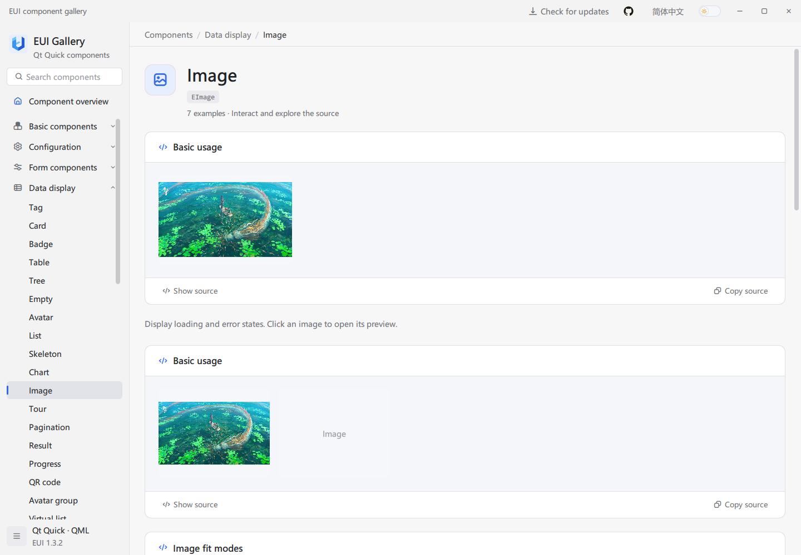
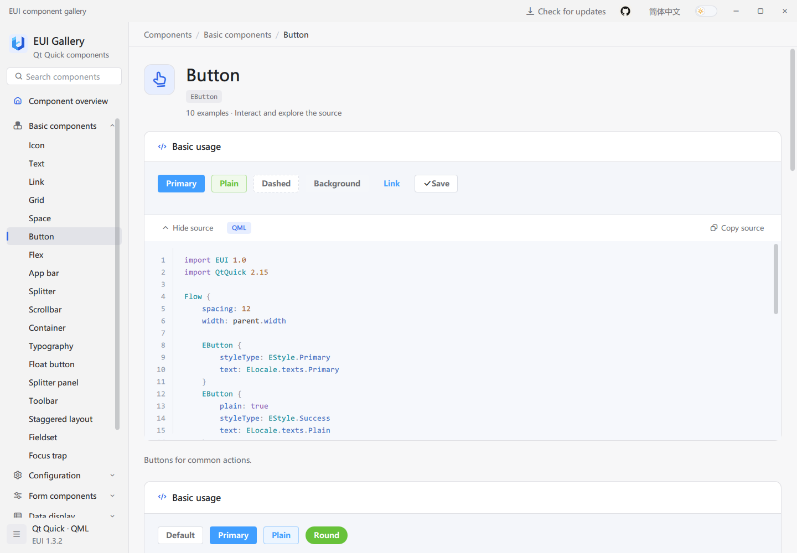

# EUI-PySide6 Usage Guide

[简体中文](guide.zh-CN.md) | English · [Back to the project](../README.md)

Use `import EUI 1.0` in QML. Initialize the Python services before loading a window. The public controls and Gallery follow EUI; Python replaces the original C++ support plugin.

| Goal | Follow in order | Success looks like |
| --- | --- | --- |
| Try existing components | Section 1 → Section 2.1 | Gallery opens with interactive examples and source |
| Create your application | Section 1 → Section 2.2 → Section 3 | The button displays a greeting using the input text |
| Integrate an existing project | Section 1 → Section 2.2 → Section 3.3 | Your Python/QML window can use EUI |

## 1. Prerequisites

Install 64-bit Python 3.10 or newer and Git. Desktop release builds use Python 3.12 and PySide6 6.8.3. `pip install` installs PySide6, Pillow, and qrcode. No C++ compiler or original EUI plugin is required. Packaged Gallery downloads include their runtime. Windows x86 packages are not provided.

In PowerShell, run the following from your intended parent directory:

```powershell
git clone https://github.com/lihechuan/EUI-PySide6.git
cd EUI-PySide6
python -m venv .venv
.\.venv\Scripts\python.exe -m pip install -e .
.\.venv\Scripts\python.exe main.py --language en
```

On macOS use `python3 -m venv .venv` and replace `.\.venv\Scripts\python.exe` with `./.venv/bin/python` in subsequent commands. Always use the environment's Python for installation and startup.

## 2. Build EUI

### 2.1 Try the Gallery

Run `python main.py --language en` using the environment above. Search for `EButton`, try an example, and select **Show source** or **Copy source**. Add `--dark` for the dark theme or `--component ETable` to open a component directly. The application defaults to Chinese without `--language en`.

### 2.2 Install the library for your application

Download the `.whl` from [GitHub Releases](https://github.com/lihechuan/EUI-PySide6/releases), then install it in your application's environment:

```powershell
python -m pip install ./eui_pyside6-1.3.2-py3-none-any.whl
```

For development, `python -m pip install -e /path/to/EUI-PySide6` installs this checkout. The distribution is named `EUI-PySide6`; its import package is `eui`. `eui_gallery` is the separate example package. The component library does not require your application to load the Gallery.

### 2.3 Resources and desktop packages

`source/` contains Python support code and its own QML files; `example/` contains the Gallery. Compiled `.rcc` files are shipped with the library. After changing QML, images, or resource lists, regenerate them with `python build/resources.py`. Startup does not invoke a compiler.

To build a wheel/source archive use `python -m pip install build` and `python -m build`. For standalone installers and portable archives, follow the [release process](release-process.en.md).

### 2.4 Open in Qt Creator

Open the root `pyproject.toml` in Qt Creator. In Python interpreter settings select this checkout's `.venv/Scripts/python.exe` (Windows) or `.venv/bin/python` (macOS). Complete `pip install -e .` with that interpreter first. Set the run script to root `main.py`, working directory to the repository root, and arguments to `--language en`. Qt Creator's Python support may need enabling in its plugin settings. A C++ Qt Kit does not replace the Python environment.

## 3. Integrate a Qt Quick application

### 3.1 Create the application

Install the wheel in your application environment. Copy these two UTF-8 files into a new directory, or start with [example/quickstart](../example/quickstart).

**`main.py`:**

```python
import os
import sys
from pathlib import Path

from PySide6.QtCore import QUrl
from PySide6.QtGui import QGuiApplication
from PySide6.QtQml import QQmlApplicationEngine

from eui import initialize


def main():
    os.environ.setdefault("QT_QUICK_CONTROLS_STYLE", "Basic")
    app = QGuiApplication(sys.argv)
    engine = QQmlApplicationEngine()
    initialize(engine, language="zh", dark=False)
    engine.load(QUrl.fromLocalFile(str(Path(__file__).resolve().with_name("Main.qml"))))
    if not engine.rootObjects():
        return 1
    result = app.exec()
    del engine
    return result


if __name__ == "__main__":
    raise SystemExit(main())
```

**`Main.qml`:**

```qml
import EUI 1.0
import QtQuick

EApplicationWindow {
    width: 640
    height: 420
    visible: true
    title: "我的 EUI 应用"

    Column {
        spacing: 16
        anchors.centerIn: parent

        EText {
            id: greeting

            text: "欢迎使用 EUI"
        }
        EInput {
            id: nameInput

            width: 260
            placeholderText: "请输入姓名"
        }
        EButton {
            text: "打招呼"
            styleType: EStyle.Primary

            onClicked: greeting.text = "你好，" + (nameInput.text || "访客")
        }
    }
}
```

### 3.2 Run and check the result

Run `python main.py` from that directory. The window opens; enter a name and click the button to update the greeting. Close and rerun after editing QML. This example loads QML directly from disk and needs no resource compilation. Your business labels can use your own translations.

### 3.3 Integrate an existing project

Keep the existing `QGuiApplication` and QML engine. Call `initialize(engine, language="en", dark=False)` before `engine.load(...)`; the return value contains the EUI services. Add `import EUI 1.0` to QML and insert the required controls. Place content in `EApp` when using its message managers. Replacing the example's inner content with a component definition from section 4 is sufficient; keep its imports at the top. Initialize WebEngine as described in section 4.5 when using `EECharts`.

## 4. Common features: purpose and usage

The following blocks are component definitions with their required imports. Place each root object inside a window as described in section 3.3, and keep imports at the top of the file. Your application implements the business logic in signal handlers.

### 4.1 Themes, language, and configuration

**Purpose:** `ETheme` controls the global light/dark theme, `ELocale` supplies built-in Chinese and English text, and `EConfigProvider` supplies default sizes and scoped settings to child controls.

**When to use it:** Keep appearance consistent across an application, or give a particular region compact sizes, a disabled state, or a scoped locale.

```qml
import EUI 1.0
import QtQuick

EConfigProvider {
    width: 320
    height: 120
    locale: "en"
    size: EStyle.Small

    EButton {
        text: "Compact button"
        anchors.centerIn: parent
    }
}
```

Set `ELocale.language = "zh"` / `"en"` and `ETheme.dark = false` / `true` during window initialization or in a language/theme action. Sizes are `EStyle.Small`, `Medium`, and `Large`; a control's explicit size overrides its inherited default. A provider with `disabled: true` disables its descendants.

Language changes update built-in labels, hints, and Gallery text. Your own `text`, `label`, and business data do not translate automatically; use your application's localization bindings. Built-in locale resources are [zh.json](../source/qml/EUI/i18n/zh.json) and [en.json](../source/qml/EUI/i18n/en.json).

Set a provider's `locale: "en"` or `"zh"` to change built-in text only within that region for controls supporting configuration inheritance, without changing the global language. You can also pass `locale: ({name: "en", texts: {SelectAnOption: "Choose an item"}})` to override scoped built-in text.

For custom control colors, use palette methods such as `EPaletteManager.ThemePalette.textRegular(ETheme.dark)` and `surfaceComponent(ETheme.dark)`. For status colors, use `fetchColorForStyle(EStyle.Primary)`.

### 4.2 Forms and selectors

**Purpose:** `EForm` manages a model and validation rules, while `EFormItem` connects a model field to its input. `ESelect` separates display labels from selected values.

**When to use it:** Settings, profile editors, filters, or forms that must validate data before submission.

```qml
import EUI 1.0
import QtQuick

Column {
    width: 480
    spacing: 16

    EForm {
        id: form

        width: parent.width
        model: ({name: ""})
        rules: ({name: [{required: true, message: "Enter a name"}]})

        onSubmitted: {
            if (valid)
                console.log("Submit name", model.name)
        }

        EFormItem {
            prop: "name"
            label: "Name"
            width: parent.width

            EInput {
                width: parent.width
                placeholderText: "Enter a name"
            }
        }
    }
    EButton {
        text: "Submit"

        onClicked: form.submit()
    }
}
```

`prop` names the model field; `submit()` validates and emits `submitted(valid, model)`. Use `validate(callback)` for validation alone, `resetFields()` to restore initial values, and `clearValidate()` to remove validation feedback. For asynchronous rules, read the final result in a callback or completion signal.

```qml
import EUI 1.0
import QtQuick

ESelect {
    width: 240
    value: "list"
    clearable: true
    textRole: "label"
    valueRole: "value"
    placeholderText: "Choose a view"
    model: [{label: "List", value: "list"}, {label: "Grid", value: "grid"}]

    onChanged: console.log(value)
}
```

`textRole` identifies the displayed label, and `valueRole` identifies the business value. Set `value` to select an option; `clear()` clears selection. An option with `disabled: true` cannot be selected.

`EDatePicker.value` uses `yyyy-MM-dd`. Restrict the range with `minDate` / `maxDate`; `disabledDate(date)` receives a JavaScript `Date`. Use `EDatePickerPanel` for an embedded date panel.

### 4.3 Tables, trees, and long lists

**Purpose:** `ETable` separates row data from column settings; `ETree` displays parent/child nodes; `EListy` creates and reuses delegates on demand for long lists.

**When to use it:** Data records, file hierarchies, navigation trees, and large scrollable collections.

```qml
import EUI 1.0
import QtQuick

ETable {
    width: 640
    height: 280
    model: [{name: "Alice", score: 92}, {name: "Bob", score: 88}]
    columns: [
        {prop: "name", label: "Name"},
        {prop: "score", label: "Score", width: 120, sortable: true}
    ]

    onRowClicked: console.log(index, row.name)
}
```

`columns[].prop` names a row field, and `label` is its heading. Set a viewport height; row delegates are created with `ListView`. Call `sort("score", "ascending")` or `sort("score", "descending")`; an empty order clears sorting. The column must have `sortable: true`.

`currentRowIndex` and `selectRow(index)` refer to the original model index, including after sorting. `currentRow` returns the selection; `clearSelection()` clears it. Replace the entire `model` array to notify QML about updates. See the Gallery's `ETable` page for editing, filters, tree rows, toolbars, and export settings.

```qml
import EUI 1.0
import QtQuick

ETree {
    width: 320
    height: 240
    expandedKeys: ["root"]
    model: [{
        id: "root",
        label: "Workspace",
        children: [{id: "docs", label: "Documents"}]
    }]

    onNodeSelected: console.log(key, node.label)
}
```

Give each node a unique string `id` for a stable key. Use `select(key)` and `setExpanded(key, expanded)`, and read `currentKey` / `currentNode`. Disabling a parent disables its descendants.

Choose a list component according to data size and presentation needs:

| Component | Usage |
| --- | --- |
| `EList` / `EListItem` | Display titles, descriptions, avatars, and actions from a JavaScript array, with pagination and a responsive grid; configure `grid` using `columns`, `gutter`, and `itemHeight` |
| `EListy` | Assign a JavaScript array to `items`, set viewport dimensions and `rowKey`, and create/reuse delegates on demand by default for long lists |
| `EInfiniteScroll` | Use with `QAbstractItemModel`, `ListModel`, or incremental loading |

For `EListy`, use items such as `{id: 10, title: "Alpha", category: "A"}` and set `rowKey: "id"`. Group by a field with `group: ({key: "category"})`; `group.key` also accepts an `(item) => key` function. Assign a new `items` array to update the list.

Call `scrollTo(200)` for pixel scrolling, or `scrollTo({key: 10, align: "top", offset: 8})` to position a stable key; `align` supports `top/bottom/auto`. `scrollTo({groupKey: "A", align: "top"})` targets the first item in a group. Invalid requests and missing or duplicate keys return `false`. Read `errorString` if a grouping callback fails.

A custom `itemDelegate` can declare `itemData`, `itemIndex`, `itemKey`, `groupKey`, and `listControl`; the component updates these fields. Disabling `virtual` caches all content and is suited to small datasets.

### 4.4 Uploads and application messages

**Purpose:** `EUpload` provides file selection, queue management, and upload interactions. `EApp` supplies `message`, `modal`, and `notification` managers for a content region.

**When to use it:** Attachments, image uploads, save feedback, or business confirmations.

```qml
import EUI 1.0
import QtQuick

EUpload {
    limit: 3
    width: 480
    maxFileSize: 5 * 1024 * 1024
    nameFilters: ["Images (*.png *.jpg)"]

    onSelected: console.log("Selected", files.length)
    onFailed: console.log(file.name, message)
    onSucceeded: console.log(file.name, response)
}
```

The default is `autoUpload: false`, so this example only selects local files. To upload, configure your HTTP(S) `action` endpoint and call `upload(index)` or `submit()`, or enable `autoUpload`. Requests use multipart with `fieldName` (default `"file"`) and optional `headers`. `maxFileSize` is in bytes; `limit: 0` means no count limit. `fileList` exposes files and their status. Use `cancel()` to abort the current upload and `removeFile(index)` to remove an entry.

Call `app.message.open("Saved")` to display a message. The complete window in section 3.2 demonstrates showing messages from a button. You can also retrieve the current instance's managers with `app.useApp()`. Place `EApp` inside a window; your application implements persistence and service calls.

### 4.5 Choosing a chart

| Component | Purpose | Use it for |
| --- | --- | --- |
| `EChart` | Native Qt line, bar, and area rendering | Simple numeric series, lower runtime overhead, and software rendering |
| `EECharts` | Local Apache ECharts hosted by Qt WebEngine | ECharts options, additional chart types, legends, zoom, and interaction events |

A native line chart:

```qml
import EUI 1.0
import QtQuick

EChart {
    width: 480
    height: 240
    type: EChart.Line
    model: [12, 18, 15, 26, 32, 28]
}
```

`EChart.type` supports `Line`, `Bar`, and `Area`. `model` accepts a numeric array or `{label, value}` data-point objects, such as `[{label: "Mon", value: 12}, {label: "Tue", value: 18}]`. `value` is numeric and `label` supplies the horizontal-axis label; omitted labels default to indices starting at 1.

An `EECharts` example:

```qml
import EUI 1.0
import QtQuick

EECharts {
    width: 640
    height: 360
    renderer: "canvas"
    option: ({
        xAxis: {type: "category", data: ["Mon", "Tue", "Wed"]},
        yAxis: {type: "value"},
        series: [{type: "bar", data: [12, 20, 16]}]
    })

    onFailed: console.log(message)
}
```

ECharts scripts, HTML, and bridge resources are bundled locally in the plugin; loading the chart engine does not require a CDN. Whether remote data or images require network access depends on your `option`. Options must be JSON-compatible, so JavaScript formatter functions cannot pass through the bridge. Read `ready` / `errorString`, use methods such as `setOption()` and `dispatchAction()`, and handle `clicked`, `legendSelected`, and `dataZoomed`.

For `EECharts`, initialize WebEngine **before** creating `QGuiApplication`:

```python
from PySide6.QtWebEngineQuick import QtWebEngineQuick
QtWebEngineQuick.initialize()
```

The Gallery already initializes the host; see [example/src/main.py](../example/src/main.py). With `QT_QUICK_BACKEND=software`, `EECharts` displays an unavailable explanation and does not create a WebEngine chart view. Remove this environment variable when using `EECharts` and verify the target machine's graphics backend. Qt Quick's software scene graph and `QT_OPENGL=software` are different settings.

### 4.6 Layouts, floating buttons, and border effects

**Purpose:** `EFlex` distributes space between children; `EFloatButton` / `EFloatButtonGroup` provide floating actions; `EBorderBeam` draws animated light along a border.

**When to use it:** Toolbars, flexible panes, shortcuts at fixed positions, and cards needing visual emphasis.

| Component | Key settings |
| --- | --- |
| `EFlex` | Set `gap` to a number or `[horizontal, vertical]`; `justify` supports `start/center/end/space-between/space-around/space-evenly`, and `align` supports `start/center/end/stretch` |
| `EFlexItem` | Wrap content that should share remaining space; `grow` / `shrink` control growth and shrinkage, `basis` sets the initial size, and `minSize` / `maxSize` constrain it |
| `EFloatButton` | Position with anchors or x/y; configure icons, text, badges, hints, and disabled state |
| `EFloatButtonGroup` | Use `trigger: "click"` or `"hover"` for an expanding menu, or an empty value for persistent actions; `placement` supports `top/bottom/left/right` |
| `EBorderBeam` | Configure `count`, `size`, `radius`, `duration`, and `color`; `duration` is in seconds, `running: false` pauses, and `reducedMotion: true` stops and hides the decoration |

Ordinary `EFlex` children retain their existing sizes; `EFlexItem` enables growth and shrinkage. `basis: -1` uses the content's implicit size, so provide `implicitWidth/implicitHeight` or set `basis` explicitly. Avoid position anchors on children managed by the layout.

Floating menus can extend beyond their group, and a parent with `clip: true` clips them. Border beams do not intercept input, so their content remains interactive. The Gallery's component pages contain complete interactions and copyable examples.

### 4.7 Call animations in one line

`EAnimation` is a singleton provided by `import EUI 1.0`; no animation object needs to be declared in the page.

```qml
EAnimation.play(card, "fadeIn")
EAnimation.play(input, "shake")
EAnimation.play(card, "bounceIn")
EAnimation.play(card, "flipInY")
EAnimation.play(card, "slideInUp", { duration: 300, distance: 24 })
```

These are separate examples; `card` and `input` are existing visual item IDs. An event handler can use `onClicked: EAnimation.play(card, "fadeIn")`.

| Category | Complete effect names | Behavior |
| --- | --- | --- |
| Fade (18) | `fadeIn`, `fadeOut`, `fadeInUp`, `fadeInDown`, `fadeInLeft`, `fadeInRight`, `fadeOutUp`, `fadeOutDown`, `fadeOutLeft`, `fadeOutRight`, `fadeInTopLeft`, `fadeInTopRight`, `fadeInBottomLeft`, `fadeInBottomRight`, `fadeOutTopLeft`, `fadeOutTopRight`, `fadeOutBottomLeft`, `fadeOutBottomRight` | Directional variants combine opacity with movement, including four diagonal directions. |
| Slide (8) | `slideInUp`, `slideInLeft`, `slideInDown`, `slideInRight`, `slideOutUp`, `slideOutDown`, `slideOutLeft`, `slideOutRight` | Slide from or toward each direction while fading in or out. |
| Scale and zoom (12) | `scaleIn`, `scaleOut`, `zoomIn`, `zoomOut`, `zoomInUp`, `zoomInDown`, `zoomInLeft`, `zoomInRight`, `zoomOutUp`, `zoomOutDown`, `zoomOutLeft`, `zoomOutRight` | Scale enters from or exits toward 85%; zoom uses 30% and can include directional movement. |
| Rotate and roll (13) | `rotateIn`, `rotateOut`, `rotateInUpLeft`, `rotateInUpRight`, `rotateInDownLeft`, `rotateInDownRight`, `rotateOutUpLeft`, `rotateOutUpRight`, `rotateOutDownLeft`, `rotateOutDownRight`, `spin`, `rollIn`, `rollOut` | Rotate around the center or a corresponding corner; roll combines movement and rotation; spin rotates once. |
| Bounce (11) | `bounce`, `bounceIn`, `bounceOut`, `bounceInUp`, `bounceInDown`, `bounceInLeft`, `bounceInRight`, `bounceOutUp`, `bounceOutDown`, `bounceOutLeft`, `bounceOutRight` | Bounce for emphasis or enter/exit with rebound, including directional variants. |
| Flip (5) | `flip`, `flipInX`, `flipInY`, `flipOutX`, `flipOutY` | Flip once around the Y axis, or enter/exit around the specified X/Y axis. |
| Attention and feedback (12) | `shake`, `pulse`, `shakeX`, `shakeY`, `swing`, `tada`, `wobble`, `jello`, `rubberBand`, `flash`, `heartBeat`, `headShake` | Shake horizontally or vertically, pulse, swing, celebrate, wobble, skew elastically, stretch, flash, or beat; shake is the compatibility name for shakeX. |
| Light speed (4) | `lightSpeedInLeft`, `lightSpeedInRight`, `lightSpeedOutLeft`, `lightSpeedOutRight` | Combine horizontal movement and skew with fading in or out. |

`EAnimation.effects` returns all 83 effect names. The optional third argument accepts:

| Option | Default | Values |
| --- | --- | --- |
| `duration` | `300` | A nonnegative integer in milliseconds; `0` completes immediately, maximum `2147483647`. |
| `distance` | `24` | Movement or shake distance in pixels, from `0` to `1000000`; affects directional movement, bounce, and shake. |
| `easing` | `Easing.OutCubic`; attention effects and bounce use `Easing.Linear` | A regular Qt easing enum, such as `Easing.InOutSine`; curves requiring additional control points are unsupported. |

`play()` returns `true` on success. A null target, unknown effect/option, or invalid number returns `false` without interrupting the current animation. Playing again on the same item replaces its animation without accumulating visual transforms; different items can animate simultaneously.

`EAnimation.stop(target)` stops playback, clears animation movement, scale, rotation, flip, and skew, and restores the opacity from before the animation took control. It returns `false` if the target has no animation record. Existing anchors, position, rotation, scale, and property bindings are preserved. Exit effects finish at opacity `0`; entering again restores the original opacity, or uses `1` for an initially transparent item. Attention effects restore the original state when finished.

Animations control visual appearance; application logic manages `visible`, `enabled`, and layout occupancy. Transparent items can still receive input. The Gallery's Visual Effects → Animation page offers eight categories plus an all-effects filter, parameter controls, previews, invocation copying, and complete example source.

### 4.8 Desktop components introduced in 1.2.0

The desktop components below were introduced in software version `1.2.0`. When a catalog entry's `introducedIn` matches the current build version, Gallery navigation shows a green **New** badge and the overview lists those components together; component details retain the introduction version. The current `1.3.2` is a fix release, so components introduced in `1.2.0` and `1.3.0` do not show current-version badges.

| Component | Purpose | Main API |
| --- | --- | --- |
| `EFilePicker` | Open files or choose a save location | `mode: "open" / "save"`, `multiple`, `nameFilters`, `folder`, `value`, `picked(value)` |
| `EFolderPicker` | Choose an existing folder | `folder`, `value`, `picked(value)`; presets `mode: "folder"` |
| `EToolBar` | Reusable actions with overflow | `model`, `showText`, `size`, `spacing`, `alignment`, `command(value, item)` |
| `ECodeView` | Read-only source highlighting and copying | `code`, `language`, `highlight`, `showLineNumbers`, `showCopy`, `copy()` |
| `ECommandPalette` | Search and execute application commands | `model`, `shortcut`, `query`, `open()`, `closeOnTrigger` |
| `EWizard` | Multi-step configuration | `model`, `currentIndex`, `beforeLeave`, `next()`, `previous()`, `finish()`, `reset()` |

Pickers use the platform dialog. `value` is a URL string for single-file, save, and folder selection, and an array of URLs for multiple-file selection. `open()`, `close()`, and `clear()` control selection. `acceptSelection(urls)` validates an external selection, preserving the old value and emitting `selectionRejected(reason)` on failure. Save mode selects a destination; the application writes the file.

Toolbar and command-palette model entries support `text`, `command`, `iconSource`, `enabled`, `visible`, `handler(item)`, and a Qt Quick Controls `Action` in `action`. Toolbar entries also support `separator`, `checkable`, `checked`, and `shortcut`; palette entries support `description` and `keywords`. Both emit `command(value, item)` after execution and `failed(message)` for exceptions. The palette defaults to `Ctrl+Shift+P`; set `shortcut: ""` to disable it.

`ECodeView` highlights `qml`, `javascript`, and `js`; other languages use plain text colors. Source is escaped before display. `copy()` preserves original source and tabs; selected display text uses four spaces for each tab.

Wizard model entries use `{title, description, disabled, component}`, with a QML `Component` for each page. Pages are loaded on first visit and retained. `beforeLeave(from, to)` may return a boolean or Promise; false rejects navigation, and `busy` is true while a Promise is pending. Finishing uses the model length as `to`. After `completed()`, call `reset()` to start again. The application handles `canceled()`. `allowJump` enables clicking steps, still subject to `beforeLeave`.

Each new component has five runnable examples in the Gallery.

### 4.9 Comparison, navigation, work components and interaction extensions in 1.3.0

Version `1.3.0` introduced 26 public types, including ECompare, EScheduler, ETaskBoard and ETextEditor, plus password rules, transfer drag/reordering, dynamic dialogs, pointer-positioned context menus, image thumbnails/flip/save and tag avatars. That version added 149 runnable Gallery scenarios and localized property documentation. See the [component and interaction reference](primevue-completion.en.md) for models, methods and scope.

### 4.10 Bundled image examples in 1.3.1

Avatar, carousel, image preview, upload, image comparison, and visual effect examples use local images bundled with the Gallery, without downloading remote sample images. Preview thumbnails load only when the preview is open and thumbnails are enabled; the error example runs only when requested.

URLs under `qrc:/example/images/gallery/...` belong to Gallery resources. When copying an example into your application, replace them with your own local or qrc URLs and declare those images in your application's resource file. Image components do not require copying all Gallery images. See the [image asset notes](../assets/images/gallery/README.md) for sources and licensing.




## 5. Learn components with the Gallery

The Gallery offers category navigation and name search on the left; `Ctrl+K` focuses search. The upper-right controls change language and theme. Component pages contain interactive examples, source actions, and API documentation below the examples.



Recommended workflow:

1. Search for a control such as `EInput` and try the interaction in its preview.
2. Expand the relevant source card to inspect its model, properties, and event handlers.
3. Copy the source into an existing window and adjust layout and business text.
4. Read the API section for defaults, signal parameters, and method purposes.
5. Implement and verify your application's models, submission logic, and network requests.

### Gallery software updates

Gallery checks for new versions at startup. Open the update panel from the top bar to view version information. When an update is available, select **Update now** to download and install it while following progress in the panel. Gallery restarts after updating and retains your language, theme, and user settings. Select **Retry check** after a network error.

Updating requires write access to the installation directory and sufficient free space. If an in-place update is unavailable, download a package for your system and architecture from [GitHub Releases](https://github.com/lihechuan/EUI/releases).

## 6. Troubleshooting

| Problem | Check |
| --- | --- |
| `No module named eui` or `eui_gallery` | Run the selected interpreter with `-m pip install -e .` from the repository root, wait for installation to finish, and use that same interpreter in Qt Creator. |
| `EUI_PySide6.egg-info` appears | This is local packaging metadata created by editable installation. It is ignored by Git and is not component source. |
| QML changes do not appear / resource registration fails | From the checkout, run `python build/resources.py` using the same environment, then restart. |
| `ETheme` / `ELocale` is undefined | Call `initialize(engine)` before loading QML, with the engine actually used by your window. |
| Chart or 3D view is unavailable | Verify the native graphics backend and required PySide6 modules. Software/offscreen tests do not establish native WebEngine or 3D rendering. |
| Portable executable cannot start | Extract the entire archive. Keep `_internal` and the executable together. On macOS copy the complete app bundle. |
| Update reports development build | Source checkouts are protected from replacement. Update with Git and reinstall the environment. |

For reports, include Python/PySide6 versions, operating system, architecture, component name, reproduction steps, and logs. Use [GitHub Issues](https://github.com/lihechuan/EUI-PySide6/issues) or `xiaojiaqaq@gmail.com`.
