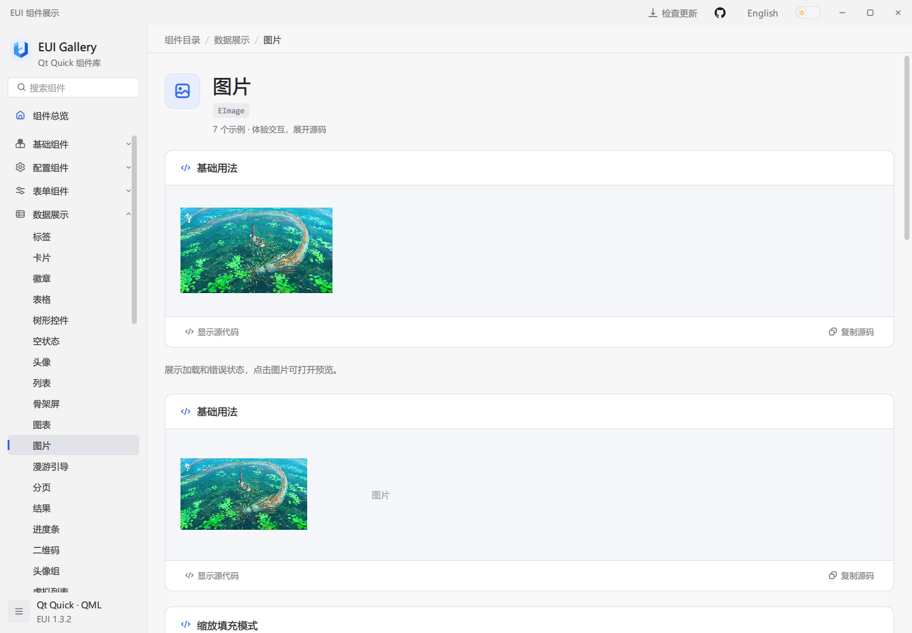
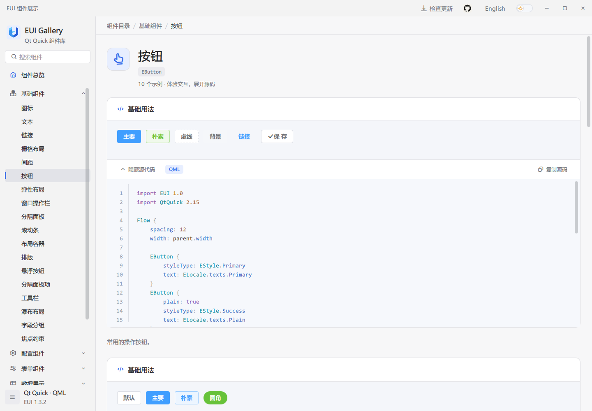

# EUI-PySide6 使用指南

简体中文 | [English](guide.en.md) · [返回项目首页](README.zh-CN.md)

在 QML 中使用 `import EUI 1.0`，加载窗口前初始化 Python 服务。公开控件和 Gallery 与 EUI 对应，原 C++ 支持插件改为 Python 实现。

| 目标 | 阅读顺序 | 成功标准 |
| --- | --- | --- |
| 体验现有组件 | 第 1 节 → 第 2.1 节 | Gallery 打开，可交互操作和查看源码 |
| 创建自己的应用 | 第 1 节 → 第 2.2 节 → 第 3 节 | 点击按钮增加计数并显示消息 |
| 接入已有项目 | 第 1 节 → 第 2.2 节 → 第 3.3 节 | Python/QML 窗口可以使用 EUI |

## 1. 环境准备

安装 64 位 Python 3.10 或更新版本和 Git。桌面发行包使用 Python 3.12 和 PySide6 6.8.3。`pip install` 会安装 PySide6、Pillow 和 qrcode，无需 C++ 编译器或原 EUI 插件。Gallery 发行包自带运行环境，不提供 Windows x86 包。

在 PowerShell 中进入希望存放仓库的父目录，执行：

```powershell
git clone https://github.com/lihechuan/EUI-PySide6.git
cd EUI-PySide6
python -m venv .venv
.\.venv\Scripts\python.exe -m pip install -e .
.\.venv\Scripts\python.exe main.py --language zh
```

macOS 使用 `python3 -m venv .venv`，后续将 `.\.venv\Scripts\python.exe` 替换为 `./.venv/bin/python`。安装与启动始终使用同一虚拟环境的 Python。

## 2. 构建 EUI

### 2.1 体验 Gallery

使用上述环境运行 `python main.py --language zh`。搜索 `EButton`，操作示例，点击“显示源代码”或“复制源码”。添加 `--dark` 使用暗色主题，添加 `--component ETable` 直接进入组件页。不传语言参数时默认中文。

### 2.2 为应用安装组件库

从 [GitHub Releases](https://github.com/lihechuan/EUI-PySide6/releases) 下载 `.whl`，在应用自己的环境中安装：

```powershell
python -m pip install ./eui_pyside6-1.3.2-py3-none-any.whl
```

开发时使用 `python -m pip install -e /path/to/EUI-PySide6` 安装源码目录。发行包名为 `EUI-PySide6`，Python 导入名为 `eui`；`eui_gallery` 是独立示例包。接入组件库无需让自己的应用加载 Gallery。

### 2.3 资源与桌面打包

`source/` 存放 Python 支持代码和独立的 QML 副本，`example/` 存放 Gallery。组件库自带编译后的 `.rcc`。修改 QML、图片或资源清单后，运行 `python build/resources.py` 重新生成；应用启动时不会调用编译器。

生成 wheel 和源码包时，执行 `python -m pip install build` 和 `python -m build`。安装包、免安装包的生成步骤见[发布流程](release-process.zh-CN.md)。

### 2.4 在 Qt Creator 中打开

在 Qt Creator 中打开根目录的 `pyproject.toml`。Python 解释器选择当前项目的 `.venv/Scripts/python.exe`（Windows）或 `.venv/bin/python`（macOS），先用这个解释器完成 `pip install -e .`。运行脚本设为根目录 `main.py`，工作目录设为仓库根目录，参数设为 `--language zh`。必要时在插件设置中启用 Python 支持。C++ Qt Kit 不能替代 Python 环境。

## 3. 接入自己的 Qt Quick 应用

### 3.1 创建应用

在应用环境中安装 wheel，将下列两个 UTF-8 文件保存到新目录；也可直接使用 [example/quickstart](../example/quickstart)。

**`main.py`：**

```python
import os
import sys
from pathlib import Path

from PySide6.QtCore import QUrl
from PySide6.QtGui import QGuiApplication
from PySide6.QtQml import QQmlApplicationEngine

from eui import initialize


def main():
    os.environ.setdefault("QT_QUICK_CONTROLS_STYLE", "Basic")
    app = QGuiApplication(sys.argv)
    engine = QQmlApplicationEngine()
    initialize(engine, language="zh", dark=False)
    engine.load(QUrl.fromLocalFile(str(Path(__file__).resolve().with_name("Main.qml"))))
    if not engine.rootObjects():
        return 1
    result = app.exec()
    del engine
    return result


if __name__ == "__main__":
    raise SystemExit(main())
```

**`Main.qml`：**

```qml
import EUI 1.0
import QtQuick

EApplicationWindow {
    id: window

    property int clickCount: 0

    readonly property bool english: ELocale.language === "en"

    width: 640
    height: 420
    visible: true
    title: "EUI Demo"

    EApp {
        id: app

        anchors.fill: parent

        Column {
            x: 24
            y: 24
            spacing: 16

            EText {
                text: (window.english ? "Clicks: " : "点击次数：") + window.clickCount
            }
            EButton {
                objectName: "addOneButton"
                text: window.english ? "Add one" : "加一"
                styleType: EStyle.Primary

                onClicked: {
                    window.clickCount += 1
                    app.message.open(window.english ? "Clicked " + window.clickCount + " times"
                        : "已点击 " + window.clickCount + " 次")
                }
            }
        }
    }
}
```

### 3.2 运行并检查

在该目录运行 `python main.py`，窗口显示“点击次数：0”。点击“加一”后显示“点击次数：1”和提示消息，再次点击显示“点击次数：2”。编辑 QML 后关闭并重新运行即可。示例直接从磁盘加载 QML，无需编译资源；业务文字可以使用应用自己的翻译。

### 3.3 接入已有项目

保留现有 `QGuiApplication` 和 QML 引擎，在 `engine.load(...)` 前调用 `initialize(engine, language="zh", dark=False)`，返回值包含 EUI 服务。QML 顶部添加 `import EUI 1.0`，放入所需控件。使用消息管理器时将内容放在 `EApp` 内。尝试第 4 节组件时替换示例内部内容，将 import 保留在文件顶部。使用 `EECharts` 时按第 4.5 节初始化 WebEngine。

## 4. 常用功能：是什么、何时用、如何用

以下代码块是组件定义，均列出所需 imports。按第 3.3 节将根对象放入窗口，imports 留在文件顶部。信号处理器中的业务逻辑由应用实现。

### 4.1 主题、语言与配置

**是什么：** `ETheme` 控制全局明暗主题，`ELocale` 提供中英文内置文本，`EConfigProvider` 为子控件提供默认尺寸和局部配置。

**何时用：** 为整套应用统一外观，或让某一区域使用紧凑尺寸、禁用状态及局部语言设置。

```qml
import EUI 1.0
import QtQuick

EConfigProvider {
    width: 320
    height: 120
    locale: "en"
    size: EStyle.Small

    EButton {
        text: "紧凑按钮"
        anchors.centerIn: parent
    }
}
```

在窗口初始化或语言切换事件中设置 `ELocale.language = "zh"` / `"en"`、`ETheme.dark = false` / `true`。`size` 支持 `EStyle.Small`、`Medium`、`Large`；控件显式设置的尺寸优先于默认值。Provider 的 `disabled: true` 会禁用其子控件。

语言切换更新内置标签、提示和 Gallery 文本。你直接写入的 `text`、`label` 和业务数据不会自动翻译，应使用应用自己的翻译或绑定。内置语言资源位于 [zh.json](../source/qml/EUI/i18n/zh.json) 和 [en.json](../source/qml/EUI/i18n/en.json)。

Provider 的 `locale: "en"` 或 `"zh"` 只设置该内容区域中支持配置继承的控件文本，不改变全局语言。也可传入 `locale: ({name: "zh", texts: {SelectAnOption: "选择项目"}})` 覆盖局部内置文案。

自定义控件颜色可使用 `EPaletteManager.ThemePalette.textRegular(ETheme.dark)`、`surfaceComponent(ETheme.dark)` 等调色板方法；状态色使用 `fetchColorForStyle(EStyle.Primary)`。

### 4.2 表单与选择器

**是什么：** `EForm` 管理模型与校验规则，`EFormItem` 关联模型字段及输入控件；`ESelect` 将显示文本与选项值分开。

**何时用：** 设置页、用户信息编辑、筛选条件或提交前必须检查数据的表单。

```qml
import EUI 1.0
import QtQuick

Column {
    width: 480
    spacing: 16

    EForm {
        id: form

        width: parent.width
        model: ({name: ""})
        rules: ({name: [{required: true, message: "请输入姓名"}]})

        onSubmitted: {
            if (valid)
                console.log("提交姓名", model.name)
        }

        EFormItem {
            label: "姓名"
            prop: "name"
            width: parent.width

            EInput {
                width: parent.width
                placeholderText: "请输入姓名"
            }
        }
    }
    EButton {
        text: "提交"

        onClicked: form.submit()
    }
}
```

`prop` 对应模型字段，`submit()` 触发校验及 `submitted(valid, model)`。通过 `validate(callback)` 仅执行校验，`resetFields()` 恢复初始字段值，`clearValidate()` 清除校验反馈。存在异步规则时，在回调或完成信号中读取最终校验结果。

```qml
import EUI 1.0
import QtQuick

ESelect {
    width: 240
    value: "list"
    clearable: true
    textRole: "label"
    valueRole: "value"
    placeholderText: "选择视图"
    model: [{label: "列表", value: "list"}, {label: "网格", value: "grid"}]

    onChanged: console.log(value)
}
```

`textRole` 是用户看到的名称，`valueRole` 是业务使用的值。通过 `value` 设置当前选项；`clear()` 清空选择。选项对象可通过 `disabled: true` 禁止选择。

日期选择使用 `EDatePicker.value`，格式为 `yyyy-MM-dd`；`minDate` / `maxDate` 限制范围，`disabledDate(date)` 接收 JavaScript `Date`。内嵌日期面板用 `EDatePickerPanel`。

### 4.3 表格、树与长列表

**是什么：** `ETable` 将行模型与列配置分开；`ETree` 展示父子节点；`EListy` 为长列表提供按需创建与复用的委托。

**何时用：** 数据台账、文件层级、导航树以及需要滚动浏览的大量条目。

```qml
import EUI 1.0
import QtQuick

ETable {
    width: 640
    height: 280
    model: [{name: "Alice", score: 92}, {name: "Bob", score: 88}]
    columns: [
        {prop: "name", label: "姓名"},
        {prop: "score", label: "分数", width: 120, sortable: true}
    ]

    onRowClicked: console.log(index, row.name)
}
```

`columns[].prop` 对应行对象字段，`label` 是列标题。设置固定的视口高度，行委托通过 `ListView` 创建。`sort("score", "ascending")` / `sort("score", "descending")` 排序，空排序字符串清除排序；列需配置 `sortable: true`。

`currentRowIndex` 和 `selectRow(index)` 使用原始模型索引，排序后仍保持该含义。`currentRow` 返回选择的行，`clearSelection()` 清除选择。替换整个 `model` 数组以通知 QML 数据更新。编辑、筛选、树行、工具栏和导出等配置见 Gallery 的 `ETable` 页面。

```qml
import EUI 1.0
import QtQuick

ETree {
    width: 320
    height: 240
    expandedKeys: ["root"]
    model: [{
        id: "root",
        label: "工作区",
        children: [{id: "docs", label: "文档"}]
    }]

    onNodeSelected: console.log(key, node.label)
}
```

给节点提供唯一字符串 `id` 作为稳定 key。通过 `select(key)` 选择节点，`setExpanded(key, expanded)` 设置展开状态；读取 `currentKey` / `currentNode` 获取选择。父节点禁用时，后代也会禁用。

列表组件按数据量和展示需求选择：

| 组件 | 用法 |
| --- | --- |
| `EList` / `EListItem` | 使用 JavaScript 数组展示标题、说明、头像及操作，支持分页和响应式网格；`grid` 可配置 `columns`、`gutter` 和 `itemHeight` |
| `EListy` | 将 JavaScript 数组赋给 `items`，设置视口宽高和 `rowKey`，默认按需创建、复用委托，适合长列表 |
| `EInfiniteScroll` | 需要直接使用 `QAbstractItemModel`、`ListModel` 或增量加载时使用 |

`EListy` 的条目可采用 `{id: 10, title: "Alpha", category: "A"}` 等对象，并设置 `rowKey: "id"`。用 `group: ({key: "category"})` 按字段分组；`group.key` 也接受 `(item) => key` 函数。更新列表时重新赋值 `items` 数组。

通过 `scrollTo(200)` 按像素滚动，或 `scrollTo({key: 10, align: "top", offset: 8})` 按稳定 key 定位；`align` 支持 `top/bottom/auto`。`scrollTo({groupKey: "A", align: "top"})` 定位到分组的首条数据。请求无效、key 重复或不存在时返回 `false`；分组回调失败时可读取 `errorString`。

自定义 `itemDelegate` 可以声明 `itemData`、`itemIndex`、`itemKey`、`groupKey` 和 `listControl` 属性，组件会更新这些字段。关闭 `virtual` 会缓存全部内容，适合少量数据。

### 4.4 文件上传与应用消息

**是什么：** `EUpload` 提供文件选择、队列及上传交互；`EApp` 为内容区域提供 `message`、`modal`、`notification` 管理器。

**何时用：** 选择附件、上传图片、提示保存结果或弹出业务确认。

```qml
import EUI 1.0
import QtQuick

EUpload {
    limit: 3
    width: 480
    maxFileSize: 5 * 1024 * 1024
    nameFilters: ["Images (*.png *.jpg)"]

    onSelected: console.log("已选择", files.length)
    onFailed: console.log(file.name, message)
    onSucceeded: console.log(file.name, response)
}
```

默认 `autoUpload: false`，上述示例仅选择本地文件。真正上传需要配置你的 HTTP(S) `action` 地址，再调用 `upload(index)` 或 `submit()`，也可以开启 `autoUpload`。请求默认使用 multipart，字段名是 `fieldName`（默认 `"file"`），可提供 `headers`。`maxFileSize` 单位为字节，`limit: 0` 表示不限制数量。`fileList` 提供文件及状态；`cancel()` 中止当前上传，`removeFile(index)` 移除条目。

用 `app.message.open("已保存")` 显示消息，第 3.2 节的完整窗口演示了按钮触发消息的用法。也可通过 `app.useApp()` 获取当前实例的管理器。`EApp` 是内容容器，需放入已有窗口；保存数据或调用服务的逻辑由应用实现。

### 4.5 图表选择

| 组件 | 是什么 | 适用情况 |
| --- | --- | --- |
| `EChart` | 使用 Qt 原生绘制的折线、柱状和面积图 | 简单数值序列、较低运行开销、软件渲染 |
| `EECharts` | 通过 Qt WebEngine 承载本地 Apache ECharts 分发文件 | ECharts option、多种图表、图例、缩放和事件交互 |

原生折线图：

```qml
import EUI 1.0
import QtQuick

EChart {
    width: 480
    height: 240
    type: EChart.Line
    model: [12, 18, 15, 26, 32, 28]
}
```

`EChart.type` 支持 `Line`、`Bar`、`Area`；`model` 可使用数值数组，也可使用 `{label, value}` 数据点数组，例如 `[{label: "周一", value: 12}, {label: "周二", value: 18}]`。`value` 是数值，`label` 用作横轴标签；省略标签时显示从 1 开始的序号。

`EECharts` 示例：

```qml
import EUI 1.0
import QtQuick

EECharts {
    width: 640
    height: 360
    renderer: "canvas"
    option: ({
        xAxis: {type: "category", data: ["Mon", "Tue", "Wed"]},
        yAxis: {type: "value"},
        series: [{type: "bar", data: [12, 20, 16]}]
    })

    onFailed: console.log(message)
}
```

该组件的 ECharts 脚本、HTML 和桥接资源在插件内本地打包，加载图表引擎不需要 CDN；远程数据或图片是否需要网络由你的 `option` 决定。`option` 必须能通过 JSON 传输，因此 JavaScript formatter 函数不能通过此桥接发送。读取 `ready` / `errorString`，使用 `setOption()`、`dispatchAction()` 等方法，并监听 `clicked`、`legendSelected`、`dataZoomed`。

使用 `EECharts` 时，在创建 `QGuiApplication` **之前**初始化 WebEngine：

```python
from PySide6.QtWebEngineQuick import QtWebEngineQuick
QtWebEngineQuick.initialize()
```


Gallery 已实现宿主初始化，可参考 [example/src/main.py](../example/src/main.py)。`QT_QUICK_BACKEND=software` 下 `EECharts` 显示不可用说明，不创建 WebEngine 图表视图。启用该组件时应移除这项环境变量，并验证目标机器的图形后端。不要将 Qt Quick 软件场景图与 `QT_OPENGL=software` 混为同一设置。

### 4.6 布局、悬浮按钮与边框效果

**是什么：** `EFlex` 分配子项空间，`EFloatButton` / `EFloatButtonGroup` 提供悬浮操作入口，`EBorderBeam` 绘制沿边框运动的装饰流光。

**何时用：** 工具栏、可伸缩面板、固定位置的快捷操作，以及需要突出显示的卡片。

| 组件 | 关键配置 |
| --- | --- |
| `EFlex` | `gap` 设置间距，可使用数字或 `[horizontal, vertical]`；`justify` 支持 `start/center/end/space-between/space-around/space-evenly`，`align` 支持 `start/center/end/stretch` |
| `EFlexItem` | 包裹需要分配剩余空间的内容；`grow` / `shrink` 控制增长和收缩，`basis` 指定基础尺寸，`minSize` / `maxSize` 限制尺寸 |
| `EFloatButton` | 通过 anchors 或 x/y 放置；可设置图标、文字、徽标、提示和禁用状态 |
| `EFloatButtonGroup` | `trigger: "click"` 或 `"hover"` 展开菜单，空值表示常驻；`placement` 支持 `top/bottom/left/right` |
| `EBorderBeam` | 设置 `count`、`size`、`radius`、`duration`、`color` 等参数；`duration` 单位为秒，`running: false` 暂停，`reducedMotion: true` 停止并隐藏装饰 |

普通 `EFlex` 子项按现有尺寸排列，使用 `EFlexItem` 才启用增长和收缩。`basis: -1` 使用内容的隐式尺寸；自定义内容应提供 `implicitWidth/implicitHeight`，或显式设置 `basis`。不要同时给布局管理的子项设置位置 anchors。

悬浮按钮组的菜单可以超出组本身的边界，父项设置 `clip: true` 时会裁剪菜单。边框流光不捕获输入，内部内容仍可操作。完整交互与可复制的示例见 Gallery 中各组件页面。

### 4.7 一行调用动画

`EAnimation` 是 `import EUI 1.0` 提供的动画单例，不需要在页面中声明动画对象。

```qml
EAnimation.play(card, "fadeIn")
EAnimation.play(input, "shake")
EAnimation.play(card, "bounceIn")
EAnimation.play(card, "flipInY")
EAnimation.play(card, "slideInUp", { duration: 300, distance: 24 })
```

以上为独立的调用示例；`card`、`input` 是已有可视控件的 `id`。在事件中使用时，可写成 `onClicked: EAnimation.play(card, "fadeIn")`。

| 分类 | 完整效果名称 | 行为 |
| --- | --- | --- |
| 淡入淡出（18） | `fadeIn`、`fadeOut`、`fadeInUp`、`fadeInDown`、`fadeInLeft`、`fadeInRight`、`fadeOutUp`、`fadeOutDown`、`fadeOutLeft`、`fadeOutRight`、`fadeInTopLeft`、`fadeInTopRight`、`fadeInBottomLeft`、`fadeInBottomRight`、`fadeOutTopLeft`、`fadeOutTopRight`、`fadeOutBottomLeft`、`fadeOutBottomRight` | 带方向的效果同时移动；含上下左右和四个对角方向。 |
| 滑入滑出（8） | `slideInUp`、`slideInLeft`、`slideInDown`、`slideInRight`、`slideOutUp`、`slideOutDown`、`slideOutLeft`、`slideOutRight` | 上下左右滑动，同时淡入或淡出。 |
| 缩放（12） | `scaleIn`、`scaleOut`、`zoomIn`、`zoomOut`、`zoomInUp`、`zoomInDown`、`zoomInLeft`、`zoomInRight`、`zoomOutUp`、`zoomOutDown`、`zoomOutLeft`、`zoomOutRight` | scale 从 85% 缩放进入或退出；zoom 从 30% 缩放进入或退出，可组合方向位移。 |
| 旋转与滚动（13） | `rotateIn`、`rotateOut`、`rotateInUpLeft`、`rotateInUpRight`、`rotateInDownLeft`、`rotateInDownRight`、`rotateOutUpLeft`、`rotateOutUpRight`、`rotateOutDownLeft`、`rotateOutDownRight`、`spin`、`rollIn`、`rollOut` | rotate 绕中心或对应角旋转进入、退出；roll 组合位移与旋转；spin 旋转一周。 |
| 弹跳（11） | `bounce`、`bounceIn`、`bounceOut`、`bounceInUp`、`bounceInDown`、`bounceInLeft`、`bounceInRight`、`bounceOutUp`、`bounceOutDown`、`bounceOutLeft`、`bounceOutRight` | 弹跳强调，或带回弹的进入、退出；支持上下左右。 |
| 翻转（5） | `flip`、`flipInX`、`flipInY`、`flipOutX`、`flipOutY` | flip 绕 Y 轴翻转一周；X/Y 变体绕对应轴进入或退出。 |
| 强调与反馈（12） | `shake`、`pulse`、`shakeX`、`shakeY`、`swing`、`tada`、`wobble`、`jello`、`rubberBand`、`flash`、`heartBeat`、`headShake` | 横向或纵向抖动、脉冲、摇摆、欢呼、晃动、弹性扭曲、拉伸、闪烁和心跳；shake 是 shakeX 的兼容名称。 |
| 快速倾斜滑动（4） | `lightSpeedInLeft`、`lightSpeedInRight`、`lightSpeedOutLeft`、`lightSpeedOutRight` | 左右位移与倾斜，同时淡入或淡出。 |

`EAnimation.effects` 返回全部 83 个效果名称。第三个参数可省略，支持以下选项：

| 选项 | 默认值 | 取值 |
| --- | --- | --- |
| `duration` | `300` | 非负整数，单位毫秒；`0` 立即完成，最大值为 `2147483647` |
| `distance` | `24` | 位移或抖动距离，单位像素；范围 `0`～`1000000`，影响方向位移、弹跳和抖动 |
| `easing` | `Easing.OutCubic`；强调类和弹跳为 `Easing.Linear` | Qt 常规缓动枚举，例如 `Easing.InOutSine`；不支持需要额外控制点的曲线 |

`play()` 成功返回 `true`。空目标、未知效果、未知选项或非法数值返回 `false`，不会中断当前动画。同一控件再次调用会替换当前动画，不会叠加视觉变换；不同控件可以同时播放。

`EAnimation.stop(target)` 停止播放并清除动画位移、缩放、旋转、翻转和倾斜，恢复动画控制前的透明度；目标没有动画记录时返回 `false`。动画保留原有 anchors、位置、旋转、缩放及属性绑定。所有退出效果完成后透明度为 `0`；再次进入恢复原透明度，原本透明的控件进入至 `1`。强调效果结束后恢复原状态。

动画只控制视觉效果，不改变 `visible`、`enabled` 或布局占位；透明控件仍可能接收输入，应由业务逻辑管理交互状态。Gallery 的“视觉效果 → 动画”页面提供 8 个分类及全部效果的筛选预览、参数调整、一行调用代码和完整示例源码。

### 4.8 1.2.0 桌面应用组件

以下桌面组件在软件版本 `1.2.0` 中引入。组件目录的 `introducedIn` 与当前构建版本一致时，Gallery 导航显示绿色“新增”标签，总览集中列出这些组件；详情保留引入版本。当前 `1.3.2` 是修复版本，`1.2.0` 和 `1.3.0` 引入的组件不会显示当前版本的新增标记。

| 组件 | 用途 | 关键接口 |
| --- | --- | --- |
| `EFilePicker` | 打开文件或选择保存位置 | `mode: "open" / "save"`、`multiple`、`nameFilters`、`folder`、`value`、`picked(value)` |
| `EFolderPicker` | 选择已有目录 | `folder`、`value`、`picked(value)`；预设 `mode: "folder"` |
| `EToolBar` | 统一操作栏，宽度不足时使用溢出菜单 | `model`、`showText`、`size`、`spacing`、`alignment`、`command(value, item)` |
| `ECodeView` | 只读源码展示与复制 | `code`、`language`、`highlight`、`showLineNumbers`、`showCopy`、`copy()` |
| `ECommandPalette` | 搜索和执行应用命令 | `model`、`shortcut`、`query`、`open()`、`closeOnTrigger`、`command(value, item)` |
| `EWizard` | 分步骤配置或导入流程 | `model`、`currentIndex`、`beforeLeave`、`next()`、`previous()`、`finish()`、`reset()` |

文件选择使用平台对话框。`EFilePicker.value` 在单选、保存和目录模式下为 URL 字符串，多选打开时为 URL 数组；显示文字会转换为本地路径。`open()` 打开对话框，`close()` 关闭，`clear()` 清空。`acceptSelection(urls)` 用于提交外部选择，校验失败发送 `selectionRejected(reason)` 并保留原值。保存模式只选择位置，不写入文件；实际写入由应用完成。

```qml
EFilePicker {
    width: 360
    mode: "open"
    multiple: true
    nameFilters: ["Text files (*.txt *.qml)", "All files (*)"]

    onPicked: console.log(value)
}
```

工具栏和命令面板的模型项支持 `text`、`command`、`iconSource`、`enabled`、`visible` 和 `handler(item)`，也可设置 `action` 为 Qt Quick Controls `Action`。工具栏还支持 `separator`、`checkable`、`checked`、`shortcut`；命令面板支持 `description`、`keywords`。执行后发送 `command(value, item)`，异常发送 `failed(message)`。命令面板默认使用 `Ctrl+Shift+P`，设为 `""` 可禁用该快捷键。

```qml
EToolBar {
    width: 360
    model: [{text: "打开", command: "open", iconSource: EIcons.FOLDER},
        {text: "保存", command: "save", iconSource: EIcons.COPY}]

    onCommand: console.log(value)
}
```

`ECodeView` 高亮 `qml`、`javascript` 或 `js`，其他语言按纯文本颜色展示；不会解析或执行源码中的 HTML。`copy()` 复制原始源码，包括制表符；文本选择复制则使用显示文本，制表符展示为四个空格。

向导模型项使用 `{title, description, disabled, component}`，其中 `component` 是页面的 `Component`。默认首次进入才加载并保留页面内容。`beforeLeave(from, to)` 返回 `false` 阻止导航，返回 Promise 时等待完成，`busy` 为 true；完成操作的 `to` 为模型长度。`completed()` 后可调用 `reset()` 重新开始，`canceled()` 由应用决定如何关闭或清理。`allowJump` 允许点击步骤条跳转，仍执行离开校验。

```qml
EWizard {
    id: wizard

    width: 520
    model: [{title: "基本信息", component: firstPage},
        {title: "确认", component: reviewPage}]
    beforeLeave: function(from, to) {
        return to <= from || from !== 0 || wizard.currentPage.text.length > 0
    }

    Component {
        id: firstPage

        EInput { placeholderText: "输入名称" }
    }
    Component {
        id: reviewPage

        EText { text: "确认后点击完成" }
    }
}
```

### 4.9 1.3.0 对比、导航、工作组件与交互扩展

`1.3.0` 引入 ECompare 等 26 个公开类型，并补充密码规则、穿梭框拖动排序、动态弹窗、右键定位、图片缩略图/翻转/保存及标签头像。该版本为 Gallery 增加 149 个可运行场景，属性说明提供中英文。完整入口、模型和操作方法见[新增组件与功能扩展](primevue-completion.md)。

### 4.10 1.3.1 本地图片示例

头像、轮播、图片预览、上传、图片对比和视觉效果示例使用随 Gallery 打包的本地图片，无需下载远程示例图片。图片预览只在打开并启用缩略图时加载缩略图；错误示例需点击后才触发。

示例中的 `qrc:/example/images/gallery/...` 属于 Gallery 资源。复制到自己的应用时，将图片 URL 替换为自己的本地或 qrc 资源，并在应用的资源文件中声明；接入图片组件不需要复制 Gallery 的全部图片。资源来源与许可见[图片资源说明](../assets/images/gallery/README.md)。




## 5. 使用 Gallery 学习组件

Gallery 左侧提供分类导航和名称搜索；`Ctrl+K` 聚焦搜索框。右上角切换语言和主题。每个组件页面包含可操作的示例卡片、源码按钮及页面下方的 API 文档。



推荐按以下顺序学习：

1. 搜索控件名，例如 `EInput`，先在预览中验证所需交互。
2. 展开对应卡片的源码，确认输入模型、关键属性和事件处理器。
3. 复制源码到已有窗口，调整布局及业务文字。
4. 阅读页面下方的 API，确认默认值、信号参数和方法用途。
5. 为自己的业务模型、提交或网络请求编写逻辑，并验证实际结果。

### Gallery 软件更新

Gallery 启动时检查新版本。点击顶部的更新按钮查看版本信息；有新版时点击“立即更新”，可在面板中查看下载和安装进度。更新完成后 Gallery 自动重启，语言、主题和用户设置保留。网络连接失败时可点击“重新检查”。

更新需要安装目录的写入权限和足够的可用空间。无法直接更新时，可从 [GitHub Releases](https://github.com/lihechuan/EUI-PySide6/releases) 下载适合当前系统和架构的版本。

## 6. 常见问题

| 问题 | 检查方法 |
| --- | --- |
| `No module named eui` 或 `eui_gallery` | 在仓库根目录用选定解释器执行 `-m pip install -e .`，等待安装完成，Qt Creator 使用同一个解释器。 |
| 出现 `EUI_PySide6.egg-info` | 这是可编辑安装生成的本地包元数据，Git 已忽略，不属于组件源码。 |
| QML 修改未生效或资源注册失败 | 在源码目录使用同一环境运行 `python build/resources.py`，然后重启。 |
| `ETheme` / `ELocale` 未定义 | 在实际加载窗口的引擎上先调用 `initialize(engine)`，再加载 QML。 |
| 图表或三维视图不可用 | 检查原生图形后端及 PySide6 模块。软件或无界面测试不能证明原生 WebEngine、三维渲染正常。 |
| 免安装包无法启动 | 完整解压，保留 `_internal` 与可执行文件的相对位置；macOS 保留完整 app bundle。 |
| 更新提示开发版本 | 源码目录受到保护，不允许更新器覆盖；使用 Git 更新后重新安装环境。 |

反馈时提供 Python/PySide6 版本、操作系统、架构、组件名、复现步骤和日志。使用 [GitHub Issues](https://github.com/lihechuan/EUI-PySide6/issues) 或 `xiaojiaqaq@gmail.com`。
